<h2>TensorFlow-FlexUNet-Image-Segmentation-Lung-Cancer-CT (2026/10/30)</h2>
Sarah T. Arai 
Software Laboratory antillia.com  
This is the first experiment of Image Segmentation for <b>Lung-Cancer-CT </b>
 based on
our <a href="https://github.com/sarah-antillia/TensorFlow-FlexUNet-Image-Segmentation-Model">TensorFlowFlexUNet Model</a>
 (<b>TensorFlow Flexible UNet Image Segmentation Model for Multiclass</b>) and a 512x512-pixel PNG
 <a href="https://drive.google.com/file/d/1DpiKniZ2xSOI_VJqsgbx6K6KzPDp43g-/view?usp=sharing">
Augmengted-Lung-Cancer-CT-ImageMask-Dataset.zip</a> (<a href="https://creativecommons.org/licenses/by-sa/4.0/">CC BY-SA 4.0</a>)
which was derived by us from the Kaggle  
  
<a href="https://www.kaggle.com/datasets/aminasirinechieb/lung-cancer-segmentation-lung-rads">
<b>Lung cancer segmentation (Lung-RADS)</b>
</a> by Amina Sirine CHIEB .
  

<b>Actual Image Segmentation for Lung-Cancer-CT Images of 512x512 pixels</b> 
As shown below, the inferred masks resemble the ground-truth masks.  
 
<table>
<tr>
<th width="320" height="auto">Input: image</th>
<th width="320" height="auto">Mask (ground_truth)</th>
<th width="320" height="auto">Prediction: inferred_mask</th>
</tr>
<tr>
<td>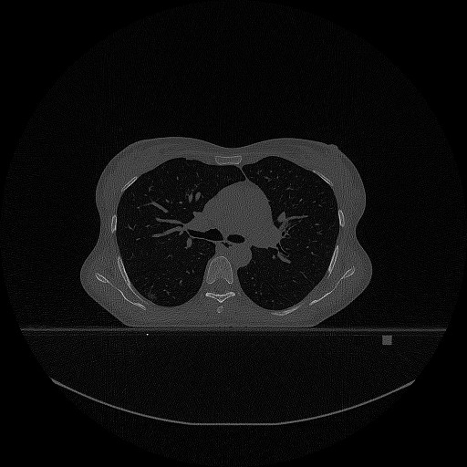</td>
<td></td>
<td></td>
</tr>
<tr>
<td>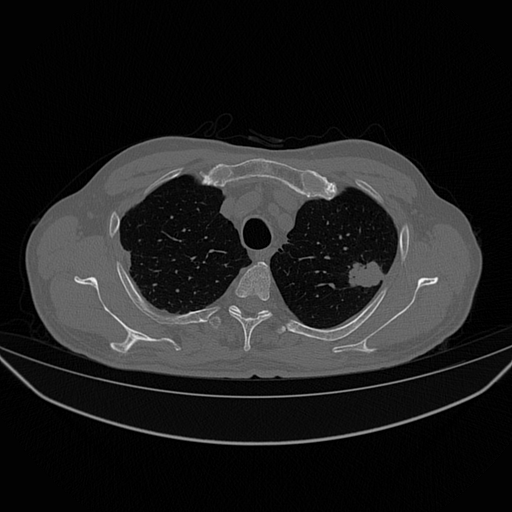</td>
<td></td>
<td></td>
</tr>
<tr>
<td>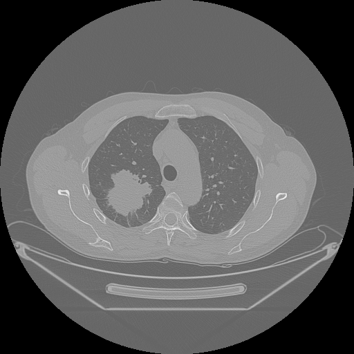</td>
<td></td>
<td></td>
</tr>
</table>

 
<h3>1. Dataset Citation</h3>
The dataset used here was derived from the following Kaggle:  
<a href="https://www.kaggle.com/datasets/aminasirinechieb/lung-cancer-segmentation-lung-rads">
<b>Lung cancer segmentation (Lung-RADS)</b>
</a>  
<b>CT images paired with corresponding masks meticulously labelled by radiologists
</b> 
by Amina Sirine CHIEB .
  
The following explanation was taken the website above.
  
<b>About Dataset</b> 
The lung cancer segmentation dataset comprises CT images paired with corresponding lung cancer masks, meticulously labeled by radiologists 
according to the Lung-RADS System. This dataset is a fusion of original Kazakhstani local data from the Kazakh Research Institute of Oncology 
and Radiology, and the openly available LIDC-IDRI dataset [1], which has been re-labeled. The entire dataset has been divided into training 
and testing sets, with the training set consisting of 708 CT images and the test set containing 264 CT images. All images share a 
standardized labeling format:
 
• label1 – class according to Lung-RADS System 
• mask – binary mask of lung cancer area 
• hu_array_old – CT image converted standardized in Hounsfield Units 
• hu_array – CT image with dropped non-lung area via thresholding-based algorithm 
 
Important! Fields label1 and mask have been manually labeled by the doctor-radiologist, 
hu_array has been labeled via automated thresholding-based algorithm and was not additionally checked by the human eye.
  
<pre>
[1] Armato III, S. G., McLennan, G., Bidaut, L., McNitt-Gray, M. F., Meyer, C. R., Reeves, A. P., Zhao, B., Aberle, D. R., 
Henschke, C. I., Hoffman, E. A., Kazerooni, E. A., MacMahon, H., Van Beek, E. J. R., Yankelevitz, D., Biancardi, A. M., 
Bland, P. H., Brown, M. S., Engelmann, R. M., Laderach, G. E., Max, D., Pais, R. C. , Qing, D. P. Y. , Roberts, R. Y., 
Smith, A. R., Starkey, A., Batra, P., Caligiuri, P., Farooqi, A., Gladish, G. W., Jude, C. M., Munden, R. F., 
Petkovska, I., Quint, L. E., Schwartz, L. H., Sundaram, B., Dodd, L. E., Fenimore, C., Gur, D., Petrick, N., Freymann, 
J., Kirby, J., Hughes, B., Casteele, A. V., Gupte, S., Sallam, M., Heath, M. D., Kuhn, M. H., Dharaiya, E., Burns, R., 
Fryd, D. S., Salganicoff, M., Anand, V., Shreter, U., Vastagh, S., Croft, B. Y., Clarke, L. P. 
(2015). Data From LIDC-IDRI [Data set]. 
The Cancer Imaging Archive, doi: https://doi.org/10.7937/K9/TCIA.2015.LO9QL9SX
</pre>
 
Original dataset: Lung Cancer Segmentation Dataset (Lung-RADS), available on Mendeley Data. Used here for educational and research purposes. 
 
<b>Citation</b>
<pre>
 Nam, Diana; Panina, Alexandra; Pak, Alexandr (2024), 
 “Lung cancer segmentation dataset with Lung-RADS class”, 
 Mendeley Data, V1, doi: 10.17632/5rr22hgzwr.1 
</pre>
 
<b>License</b> 
<a href="https://creativecommons.org/licenses/by-sa/4.0/">CC BY-SA 4.0</a>
 
 
<h3>
2. Lung-Cancer-CT ImageMask Dataset
</h3>
<h3>2.1 Download ImageMask Dataset</h3>
 If you would like to train this Lung-Cancer-CT Segmentation model,
 please download the dataset from Google Drive  
 <a href="https://drive.google.com/file/d/1DpiKniZ2xSOI_VJqsgbx6K6KzPDp43g-/view?usp=sharing">
Augmented-Lung-Cancer-CT-ImageMask-Dataset.zip</a>. 
Expand the downloaded ImageMaskDataset and put it under the <b>./dataset</b> folder.
 
<pre>
./dataset
└─Lung-Cancer-CT
    ├─test
    │   ├─images
    │   └─masks
    ├─train
    │   ├─images
    │   └─masks
    └─valid
         ├─images
         └─masks
</pre>
 
<b>Lung-Cancer-CT Statistics</b> 
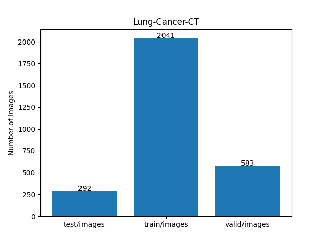 
 
As shown above, the number of images in the training and valid datasets is large enough to use for the
 training set of our segmentation model.
 
<h3>2.2 Derivation of ImageMask Dataset</h3>
The folder structure of the original dataset  
</a> is as follows.
<pre>
./lung_segmentation
  ├─lung_cancer_test.pkl
  └─lung_cancer_train.pkl
</pre>
We generated a 512x512-pixel PNG ImageMask dataset  
from the Pickle files by using a simple Python script <a href="./generator/ImageMaskDatasetGenerator.py">ImageMaskDatasetGenerator.py</a>.
We geneated our masks and images of our dataset
from "mask" and "hu_array_old" data (not "hu_array") 
in the Pickle files.
  
<h3>2.3 Train Sample Images and Masks</h3>
<b>Train_sample_images</b> 
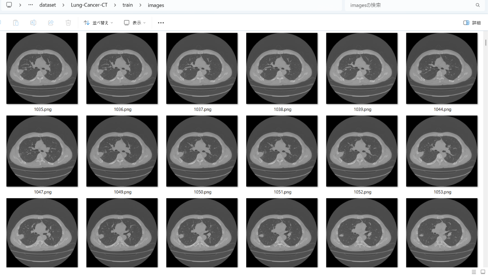
 
<b>Train_sample_masks</b> 
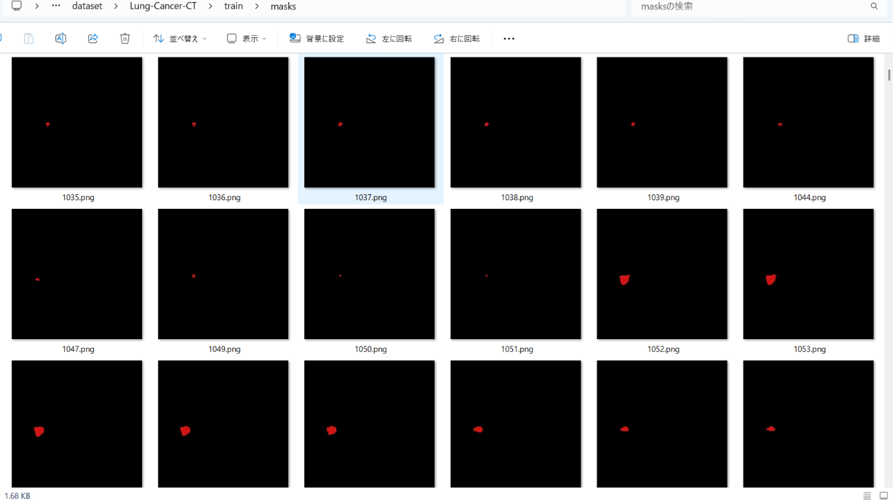
 
<h3>
3. Train TensorFlowFlexUNet Model
</h3>
 We trained the Lung-Cancer-CT TensorFlowFlexUNet model using the following
<a href="./projects/TensorFlowFlexUNet/Lung-Cancer-CT/train_eval_infer.config"> <b>train_eval_infer.config</b></a> file.  
Please move to ./projects/TensorFlowFlexUNet/Lung-Cancer-CT and run the following bat file. 
<pre>
>1.train.bat
</pre>
This runs the following command. 
<pre>
>python ../../../src/TensorFlowFlexUNetTrainer.py ./train_eval_infer.config
</pre>

<b>Model parameters</b> 
Defined a small <b>base_filters=16 </b> and large <b>base_kernels=(11,11)</b> for the first Conv Layer of Encoder Block of 
<a href="./src/TensorFlowFlexUNet.py">TensorFlowFlexUNet.py</a> 
and a large <b>num_layers=8</b> (including a bridge between Encoder and Decoder Blocks).
<pre>
[model]
; You may specify your own UNet class derived from our TensorFlowFlexModel
model         = "TensorFlowFlexUNet"
generator     =  False
image_width    = 512
image_height   = 512
image_channels = 3
num_classes    = 2
base_filters   = 16
base_kernels   = (11,11)
num_layers     = 8
dropout_rate   = 0.03
dilation       = (1,1)
</pre>
<b>Learning rate</b> 
Defined a small learning rate.  
<pre>
[model]
learning_rate  = 0.00007
</pre>
<b>Loss and metrics functions</b> 
Specified "categorical_focal_dice_loss" and <a href="./src/dice_coef_multiclass.py">"dice_coef_hybrid"</a>. 
<pre>
[model]
loss           = "categorical_focal_dice_loss"
metrics        = ["dice_coef_hybrid"]
hybrid_alpha   = 1.6
hybrid_beta    = 0.4
</pre>
<b>Dataset class</b> 
Specifed <a href="./src/ImageCategorizedMaskDataset.py">ImageCategorizedMaskDataset</a> class. 
<pre>
[dataset]
class_name    = "ImageCategorizedMaskDataset"
</pre>
 
<b>Learning rate reducer callback</b> 
Enabled the learning_rate_reducer callback and a small reducer_patience.
<pre> 
[train]
learning_rate_reducer = True
reducer_factor     = 0.4
reducer_patience   = 4
</pre>
<b>Early stopping callback</b> 
Enabled early stopping callback with the patience parameter.
<pre>
[train]
patience      = 10
</pre>
<b>RGB Color map</b> 
Specified RGB color map dict for Lung-Cancer-CT 2 classes. 
<pre>
[mask]
mask_datatype= "categorized"
mask_file_format = ".png"
; Lung-Cancer-CT RGB color map dict for 1+1 classes.
;      Background: black,  Cancer:dark_red
rgb_map = {(0,0,0):0,(210,20,20):1,}
</pre>

<b>Epoch change inference callback</b> 
Enabled <a href="./src/EpochChangeInferencer.py">epoch_change_infer callback</a></b>. 
<pre>
[train]
epoch_change_infer       = True
epoch_change_infer_dir   =  "./epoch_change_infer"
num_infer_images         = 6
</pre>

By using this callback, on every epoch change, the inference procedure can be called
 for 6 images in the <b>mini_test</b> folder. This will help you confirm how the predicted mask changes 
 at each epoch during your training process.  
  
<!--
As shown below, early in the model training, the predicted masks from our FlexUNet segmentation model showed 
discouraging results.
 However, as training progressed through the epochs, the predictions gradually improved. 
   
 
-->
<b>Epoch_change_inference output at starting (epoch 1,2,3)</b> 
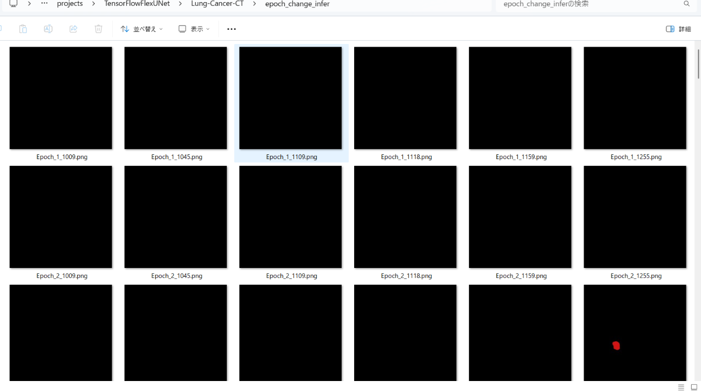 
 
<b>Epoch_change_inference output at middlepoint (epoch 14,15,16)</b> 
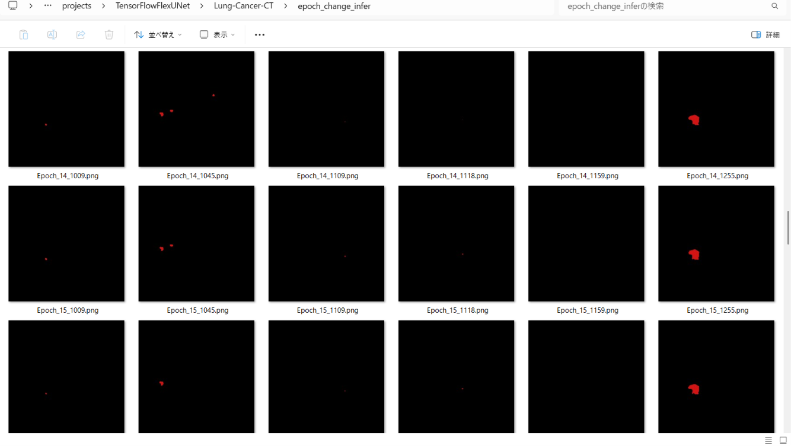 
 
<b>Epoch_change_inference output at ending (epoch 29,30,31)</b> 
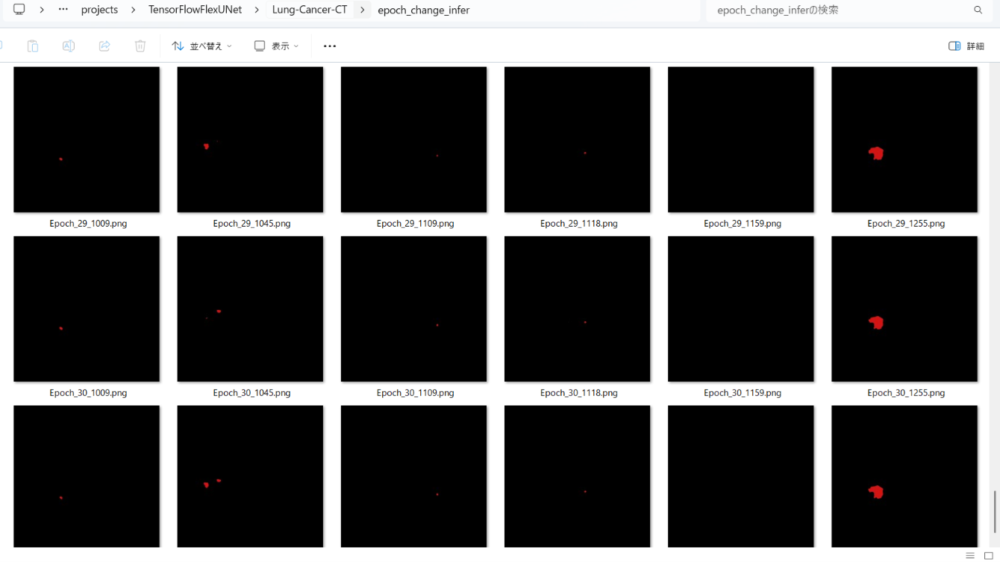 
 
In this experiment, the training process was terminated at epoch 31. 
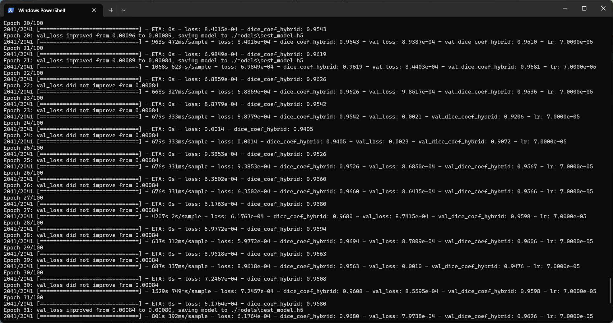 
 
<a href="./projects/TensorFlowFlexUNet/Lung-Cancer-CT/eval/train_metrics.csv">train_metrics.csv</a> 
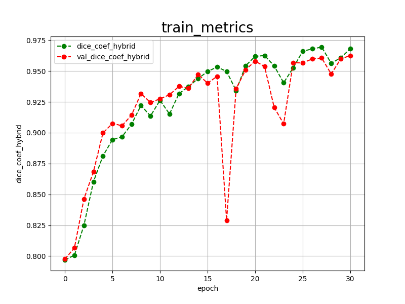 
 
<a href="./projects/TensorFlowFlexUNet/Lung-Cancer-CT/eval/train_losses.csv">train_losses.csv</a> 
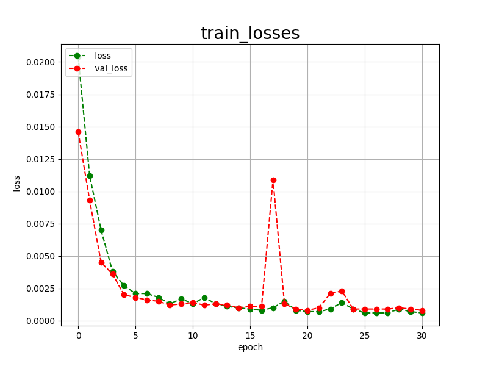 
 
<h3>
4. Evaluation
</h3>
Please move to <b>./projects/TensorFlowFlexUNet/Lung-Cancer-CT</b> folder,
and run the following bat file to evaluate the TensorFlowUNet model for Lung-Cancer-CT. 
<pre>
>./2.evaluate.bat
</pre>
This runs the following command.
<pre>
>python ../../../src/TensorFlowFlexUNetEvaluator.py ./train_eval_infer.config
</pre>

Evaluation console output: 
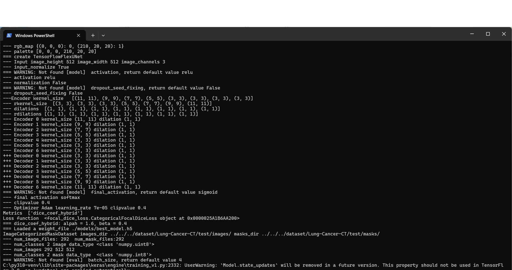
  Image-Segmentation-Lung-Cancer-CT

<a href="./projects/TensorFlowFlexUNet/Lung-Cancer-CT/evaluation.csv">evaluation.csv</a> 
The loss (categorical_focal_dice_loss) on this Lung-Cancer-CT/test was very low, and dice_coef_hybrid was high, as shown below.
 
<pre>
categorical_focal_dice_loss,0.0009
dice_coef_hybrid,0.9611
</pre>
 
<h3>
5. Inference
</h3>
Please move to <b>./projects/TensorFlowFlexUNet/Lung-Cancer-CT</b> folder
and run the following bat file to infer segmentation regions for images using the trained TensorFlowUNet model for Lung-Cancer-CT. 
<pre>
>./3.infer.bat
</pre>
This runs the following command.
<pre>
>python ../../../src/TensorFlowFlexUNetInferencer.py ./train_eval_infer.config
</pre>

<b>mini_test_images</b> 
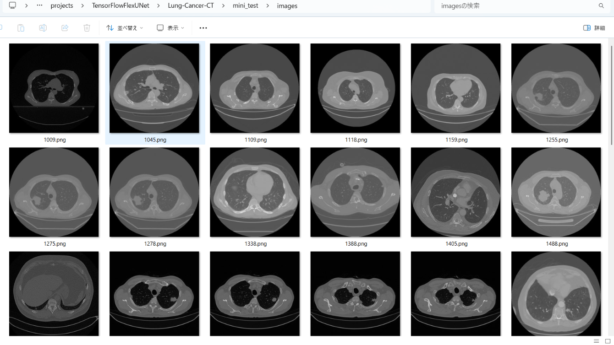 
<b>mini_test_mask(ground_truth)</b> 
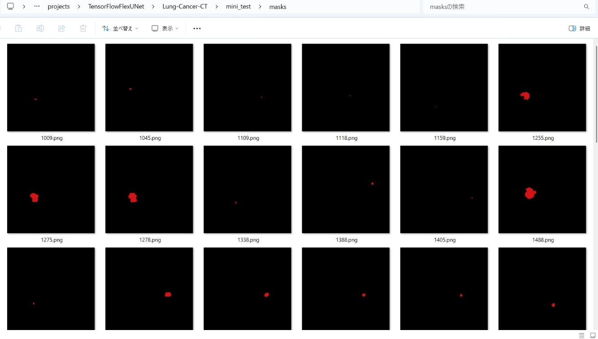 

<b>Inferred test masks</b> 
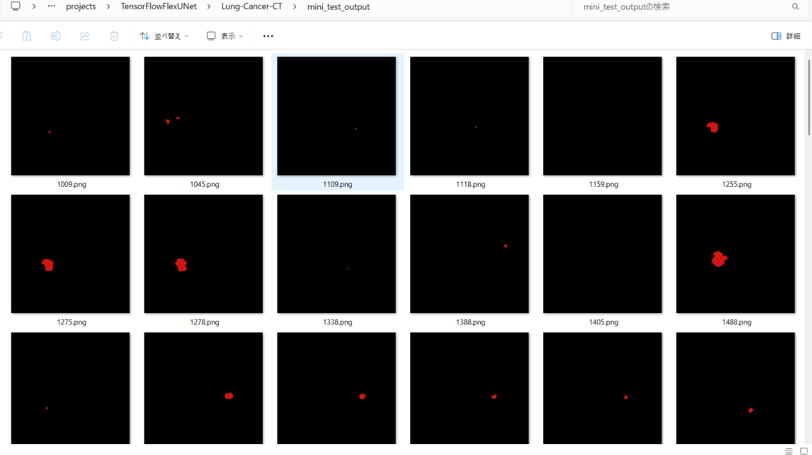 
 

<b>Enlarged images and masks for Lung-Cancer-CT Images of 512x512 pixels</b> 
As shown below, the inferred masks look similar to the ground truth masks except for the first case. 
 
<table>
<tr>
<th width="320" height="auto">Image</th>
<th width="320" height="auto">Mask (ground_truth)</th>
<th width="320" height="auto">Inferred-mask</th>
</tr>
<tr>
<td>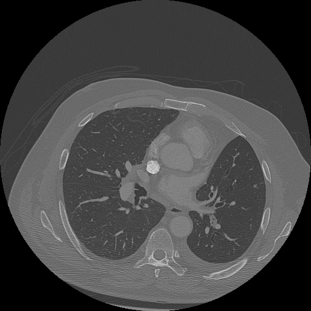</td>
<td></td>
<td></td>
</tr>
<tr>
<td>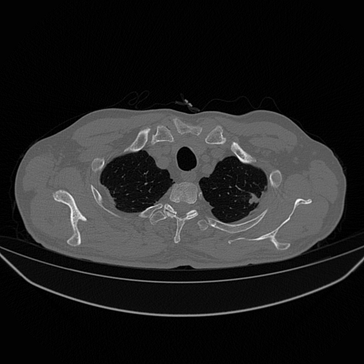</td>
<td></td>
<td></td>
</tr>
<tr>
<td>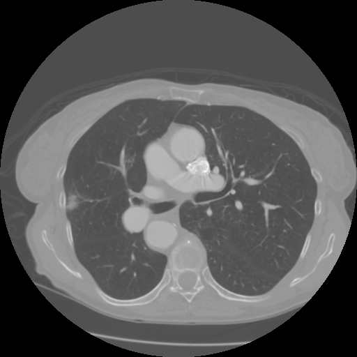</td>
<td></td>
<td></td>
</tr>
<tr>
<td>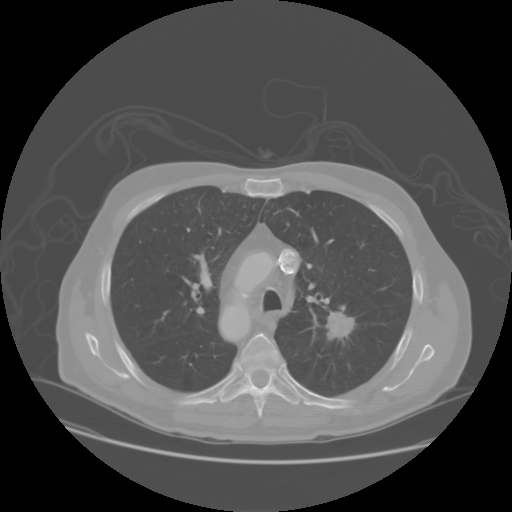</td>
<td></td>
<td></td>
</tr>
<tr>
<td>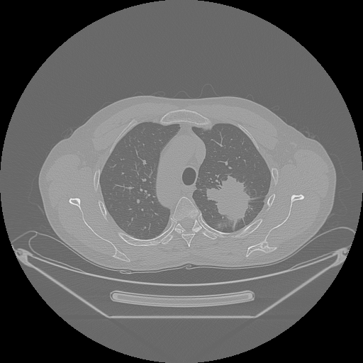</td>
<td></td>
<td></td>
</tr>
<tr>
<td>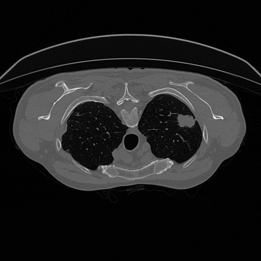</td>
<td></td>
<td></td>
</tr>
</table>

 
<h3>
References
</h3>
<b>1. Lung cancer segmentation dataset with Lung-RADS class</b> 
Nam, Diana; Panina, Alexandra; Pak, Alexandr  
(2024),  Mendeley Data, V1, doi: 10.17632/5rr22hgzwr.1  
<a href ="https://data.mendeley.com/datasets/5rr22hgzwr/1">
  https://data.mendeley.com/datasets/5rr22hgzwr/1
</a>
  
<b>2. Lung Tumor Image Segmentation from Computer Tomography Images Using MobileNetV2 and Transfer Learning</b> 
Zainab Riaz, Bangul Khan, Saad Abdullah, Samiullah Khan, Md Shohidul Islam 
<a href="https://pmc.ncbi.nlm.nih.gov/articles/PMC10451633/" >
  https://pmc.ncbi.nlm.nih.gov/articles/PMC10451633/
</a>
  
<b>3. NLSTseg: A Pixel-level Lung Cancer Dataset Based on NLST LDCT Images</b> 
Kun-Hui Chen, Yi-Hui Lin, Shawn Wu, Nai-Wen Shih, Hsing-Chen Meng, Yen-Yu Lin, Chun-Rong Huang & Jing-Wen Huang  
<a href ="https://www.nature.com/articles/s41597-025-05742-x">
https://www.nature.com/articles/s41597-025-05742-x
</a>
  
<b>4. TensorFlow-FlexUNet-Image-Segmentation-Model</b> 
Toshiyuki Arai 
<a href="https://github.com/sarah-antillia/TensorFlow-FlexUNet-Image-Segmentation-Model">
https://github.com/sarah-antillia/TensorFlow-FlexUNet-Image-Segmentation-Model
</a>
  
